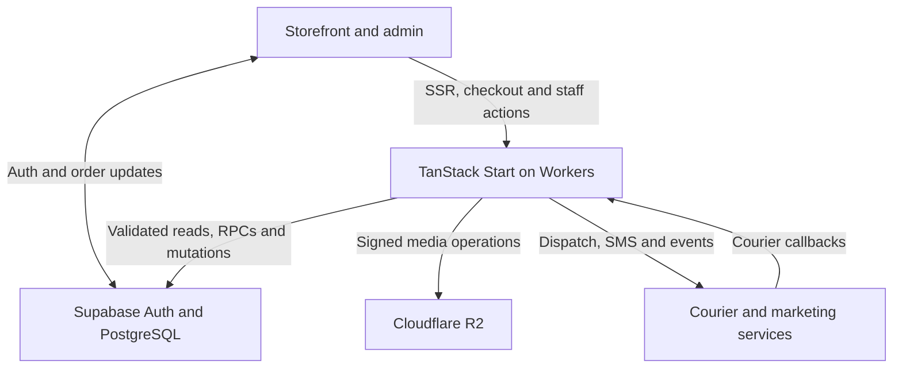

<h1 align="center">
  
</h1>

<p align="center">
  <strong>A bilingual panjabi storefront and commerce operations platform for Bangladesh</strong>
</p>

<p align="center">
  <a href="https://panjabishopbd.com/"><strong>Visit the live store</strong></a> ·
  <a href="#stack-and-versions">Tech stack</a> ·
  <a href="#storefront-and-order-flow">Order flow</a> ·
  <a href="#commerce-admin">Commerce admin</a> ·
  <a href="#integrations">Integrations</a> ·
  <a href="#developer">Developer</a>
</p>

## Overview

[Panjabi Shop BD](https://panjabishopbd.com/) sells panjabi clothing and gift combinations to shoppers in Bangladesh. Customers can browse in Bangla or English, select variants and combinations, apply offers, and order in BDT with cash on delivery. Store teams use the same application to manage the catalog, stock, orders, couriers, and marketing.

| Audience | What they can do |
| --- | --- |
| **Shoppers** | Discover products by category, search, choose sizes and variants, build eligible combos, place COD orders, and look up order receipts. |
| **Sales and support** | Create manual orders, review online and incomplete orders, resolve customer issues, send templated messages, and track delivery. |
| **Inventory and finance** | Receive purchases, adjust stock, inspect returns, reconcile movements, and review inventory cost, profitability, and monthly closing. |
| **Store administrators** | Publish content and landing pages, manage discounts and staff permissions, configure integrations, and monitor attribution and conversion delivery. |

The case-study banner uses the store’s gold-and-black mark and the storefront’s deep teal and orange accents. Shahriar Nabil’s original orange, pink, and violet mark appears as an animated watermark, with motion reduced when requested by the viewer. [Store logo](./public/logo.png) · [Site theme](./src/styles.css) · [Font notices](./src/assets/fonts/LICENSES.txt)

## Stack and versions

The versions below are resolved from [`bun.lock`](./bun.lock). Managed service versions and dashboard settings depend on the deployment.

| Technology | Locked version | Role |
| --- | --- | --- |
|  **React / React DOM** | `19.2.8` each | Storefront and admin rendering |
|  **TanStack Start / Router / Query** | `1.168.60` / `1.170.41` / `5.101.4` | SSR and server functions, file-based routes, query state and invalidation |
|  **TanStack Router plugin** | `1.168.42` | Generated route tree |
|  **TypeScript** | `5.9.3` | Application and database types |
|  **Vite / React plugin / Lightning CSS** | `8.1.5` / `5.2.0` / `1.33.0` | Dev server, bundles, and CSS processing |
|  **Tailwind CSS / Vite plugin** | `4.3.3` each | Responsive themes, typography, and utility styles |
|  **Radix Primitives** | Per primitive below | Dialogs, tabs, menus, forms, and controls |
|  **Lucide / Tiptap / Recharts** | `0.575.0` / `3.31.3` / `2.15.4` | Interface icons, rich-text editing, and operational charts |
| **React Hook Form / Zod / resolvers** | `7.83.0` / `3.25.76` / `5.5.7` | Checkout and admin validation |
|  **Nitro / H3 / Cloudflare Workers** | `3.0.260603-beta` / `2.0.1-rc.22` / managed | Worker-compatible SSR, asset output, and HTTP handlers |
|  **Supabase JS** | `2.111.0` | Auth, PostgREST, typed database access, and Realtime |
|  **PostgreSQL** | Supabase-managed | Orders, catalog, stock, permissions, RPCs, and scheduled jobs |
|  **Cloudflare R2 / aws4fetch** | managed / `1.0.20` | S3-compatible signed media operations |
|  **Bun**  **Node.js** | Toolchain, not pinned | Lockfile installation and local development |
|  **Vitest / ESLint / Prettier** | `5.0.3` / `9.39.5` / `3.9.6` | Tests, linting, and formatting |

<details>
<summary><strong>Complete direct dependency inventory</strong></summary>

| Package | Locked version | Scope |
| --- | --- | --- |
| `@hookform/resolvers` | `5.5.7` | Application |
| `@radix-ui/react-accordion` | `1.2.20` | Application |
| `@radix-ui/react-alert-dialog` | `1.1.23` | Application |
| `@radix-ui/react-aspect-ratio` | `1.1.15` | Application |
| `@radix-ui/react-avatar` | `1.2.6` | Application |
| `@radix-ui/react-checkbox` | `1.3.11` | Application |
| `@radix-ui/react-collapsible` | `1.1.20` | Application |
| `@radix-ui/react-context-menu` | `2.3.7` | Application |
| `@radix-ui/react-dialog` | `1.1.23` | Application |
| `@radix-ui/react-dropdown-menu` | `2.1.24` | Application |
| `@radix-ui/react-hover-card` | `1.1.23` | Application |
| `@radix-ui/react-label` | `2.1.15` | Application |
| `@radix-ui/react-menubar` | `1.1.24` | Application |
| `@radix-ui/react-navigation-menu` | `1.2.22` | Application |
| `@radix-ui/react-popover` | `1.1.23` | Application |
| `@radix-ui/react-progress` | `1.1.16` | Application |
| `@radix-ui/react-radio-group` | `1.4.7` | Application |
| `@radix-ui/react-scroll-area` | `1.2.18` | Application |
| `@radix-ui/react-select` | `2.3.7` | Application |
| `@radix-ui/react-separator` | `1.1.15` | Application |
| `@radix-ui/react-slider` | `1.4.7` | Application |
| `@radix-ui/react-slot` | `1.3.3` | Application |
| `@radix-ui/react-switch` | `1.3.7` | Application |
| `@radix-ui/react-tabs` | `1.1.21` | Application |
| `@radix-ui/react-toggle` | `1.1.18` | Application |
| `@radix-ui/react-toggle-group` | `1.1.19` | Application |
| `@radix-ui/react-tooltip` | `1.2.16` | Application |
| `@supabase/supabase-js` | `2.111.0` | Application |
| `@tailwindcss/vite` | `4.3.3` | Application |
| `@tanstack/react-query` | `5.101.4` | Application |
| `@tanstack/react-router` | `1.170.41` | Application |
| `@tanstack/react-start` | `1.168.60` | Application |
| `@tanstack/router-plugin` | `1.168.42` | Application |
| `@tiptap/extension-color` | `3.31.3` | Application |
| `@tiptap/extension-highlight` | `3.31.3` | Application |
| `@tiptap/extension-link` | `3.31.3` | Application |
| `@tiptap/extension-text-align` | `3.31.3` | Application |
| `@tiptap/extension-text-style` | `3.31.3` | Application |
| `@tiptap/extension-underline` | `3.31.3` | Application |
| `@tiptap/pm` | `3.31.3` | Application |
| `@tiptap/react` | `3.31.3` | Application |
| `@tiptap/starter-kit` | `3.31.3` | Application |
| `aws4fetch` | `1.0.20` | Application |
| `class-variance-authority` | `0.7.1` | Application |
| `clsx` | `2.1.1` | Application |
| `cmdk` | `1.1.1` | Application |
| `country-flag-icons` | `1.6.20` | Application |
| `date-fns` | `4.4.0` | Application |
| `embla-carousel-react` | `8.6.0` | Application |
| `input-otp` | `1.4.2` | Application |
| `lucide-react` | `0.575.0` | Application |
| `react` | `19.2.8` | Application |
| `react-day-picker` | `9.14.0` | Application |
| `react-dom` | `19.2.8` | Application |
| `react-hook-form` | `7.83.0` | Application |
| `react-resizable-panels` | `4.12.2` | Application |
| `recharts` | `2.15.4` | Application |
| `sonner` | `2.0.7` | Application |
| `tailwind-merge` | `3.6.0` | Application |
| `tailwindcss` | `4.3.3` | Application |
| `tw-animate-css` | `1.4.0` | Application |
| `vaul` | `1.1.2` | Application |
| `vite-tsconfig-paths` | `6.1.1` | Application |
| `zod` | `3.25.76` | Application |
| `@eslint/js` | `9.39.5` | Tooling |
| `@types/node` | `22.20.1` | Tooling |
| `@types/react` | `19.2.17` | Tooling |
| `@types/react-dom` | `19.2.3` | Tooling |
| `@vitejs/plugin-react` | `5.2.0` | Tooling |
| `eslint` | `9.39.5` | Tooling |
| `eslint-config-prettier` | `10.1.8` | Tooling |
| `eslint-plugin-prettier` | `5.5.6` | Tooling |
| `eslint-plugin-react-hooks` | `5.2.0` | Tooling |
| `eslint-plugin-react-refresh` | `0.4.26` | Tooling |
| `globals` | `15.15.0` | Tooling |
| `lightningcss` | `1.33.0` | Tooling |
| `nitro` | `3.0.260603-beta` | Tooling |
| `prettier` | `3.9.6` | Tooling |
| `typescript` | `5.9.3` | Tooling |
| `typescript-eslint` | `8.65.0` | Tooling |
| `vite` | `8.1.5` | Tooling |
| `vitest` | `5.0.3` | Tooling |

</details>

## Architecture

TanStack Start renders public pages on the server and exposes server functions for checkout and administration. Supabase provides Auth, PostgreSQL, and order change subscriptions. Nitro builds the Worker at `dist/server/index.mjs` and the client files at `dist/client`, which are served through the Worker’s `ASSETS` binding.



[Server entry](./src/server.ts) · [Build configuration](./vite.config.ts) · [Worker configuration](./wrangler.jsonc) · [Database migrations](./supabase/migrations)

## Storefront and order flow

1. **Discover and select.** Browse categories, search products, switch language, choose variants, and shop promotions or configurable gift combinations. The storefront includes campaign landing pages and a cart.
2. **Validate the order.** The guest checkout collects delivery details and a phone number. The server checks Turnstile when configured, loads current products and variants, recalculates prices and delivery, validates coupons, and places the COD order through the PostgreSQL checkout RPC.
3. **Fulfill and reconcile.** Staff can review an online order or create one manually, assign courier fulfillment, and follow shipment events. Inventory and packaging operations, returns, and courier settlement are handled in the operations console.
4. **Track and follow up.** Customers can look up receipts using order and phone details. The admin can manage activity notes, send SMS, review incomplete checkout captures, and inspect courier and conversion outcomes.

[Checkout](./src/components/site/checkout-form.tsx) · [Order functions](./src/lib/order.functions.ts) · [Courier dispatch](./src/lib/dispatch.server.ts) · [Fulfillment stock](./src/lib/inventory-fulfilment.server.ts)

## Commerce admin

| Area | Modules |
| --- | --- |
| **Catalog and merchandising** | Products, variants, sub-products, configurable combo boxes, categories and subcategories, promotions, coupons, media, and product SEO. |
| **Orders and fulfillment** | Web orders, lists and search, manual order creation, activity history, customer and source panels, courier dispatch, and order status updates. |
| **Inventory and purchasing** | Stock alerts and reorder rules, purchase orders and receiving, live stock, packaging, supplier payments, loss and damage, stock counts, RTO inspection, and reconciliation. |
| **Reporting and closing** | Inventory reports, cost visibility, profit and loss, monthly closing, and permissioned exports. |
| **Marketing** | Overview, campaigns, creatives, attribution, audiences, controls, automation runs, and tracking debug with event delivery status. |
| **Content and settings** | Landing-page editor, FAQs, site and legal content, delivery pricing and courier settings, SMS templates, API connections, and data-retention controls. |
| **Staff** | Module-level grants and separate capability flags for actions such as viewing inventory costs, exporting data, or applying manual discounts. |

[Admin shell](./src/routes/admin.tsx) · [Role and module definitions](./src/lib/rbac-shared.ts) · [Landing editor](./src/routes/admin.landing.tsx) · [Inventory functions](./src/lib/inventory.functions.ts)

## Identity, security and data

| Capability | Implementation |
| --- | --- |
|  **Authentication** | Supabase email/password sign-in and registration with Google OAuth. The admin entrance evaluates staff access, account activity, and session state. |
| **RBAC and RLS** | Per-module staff grants, server-side role checks, bearer claim validation, and PostgreSQL RLS policies. Privileged credentials are resolved server-side. |
|  **Realtime** | Supabase Postgres Changes updates the order board and detail queries. A separate presence subscription shows staff activity on orders. |
|  **Bot and request checks** | Turnstile components and server token verification, plus request context and customer risk signals used in order operations. |
| **Data handling** | The storefront saves cart and draft state in the browser. An incomplete checkout can be recorded after a phone number is entered. The admin provides retention controls for order logs and webhook data. |
| **Payment scope** | The checkout records cash on delivery. The courier settlement workflow reconciles COD collection. |

[Auth route](./src/routes/auth.tsx) · [Auth middleware](./src/integrations/supabase/auth-middleware.ts) · [Order Realtime](./src/lib/use-order-realtime.ts) · [Presence](./src/lib/use-order-presence.ts) · [Privacy policy](https://panjabishopbd.com/privacy-policy)

## Integrations

The repository implements these integrations. Sending events, importing data, and dispatching couriers depend on the corresponding credentials and operational settings.

| Integration | Purpose |
| --- | --- |
|  **Pathao Courier** | Courier credentials, store and location data, consignment dispatch, and tracking. |
|  **Steadfast** | Consignments, courier event updates, and scheduled COD payment reconciliation. |
|  **CarryBee** | Delivery areas, single or bulk dispatch, and consignment tracking. |
|  **BD Courier** | Customer courier history and risk checks when configured. |
|  **BulkSMSBD** | Template-based order SMS and admin messaging. |
|  **Cloudflare R2** | Object storage for media, with S3-signed operations and optional Cloudflare image delivery transformations. |
|  **Google Tag Manager** | Configurable browser container and data-layer events. The importable template covers analytics and advertising tags. |
|  **Google Analytics 4** | Browser tag events through GTM and server-side Measurement Protocol events for configured order transitions. |
|  **Meta** | Marketing API and Conversions API, with browser/server event IDs used for deduplication. |
|  **TikTok** | Pixel and Events API wiring for funnel and order events, including order placement and completed payment stages. |

Courier callbacks are handled through `/api/public/courier/$provider`. Conversion dispatch maps events to order states and records delivery outcomes for inspection and retry. The GTM template also includes Microsoft Clarity wiring. [Courier callback](./src/routes/api/public/courier.%24provider.ts) · [Conversion dispatch](./src/lib/tracking-dispatch.server.ts) · [GTM setup](./docs/gtm-template.md) · [Integration settings](./src/routes/admin.settings.api.tsx)

## Search and product discovery

-  **Google Search Console.** The live storefront returns a site-verification meta tag, and public DNS contains a Google verification TXT record. Search Console owns the property and indexing reports.
-  **Structured data.** The homepage emits `Organization`, `OnlineStore`, and `WebSite` markup. Product routes include `Product`, `Offer`, breadcrumbs, and FAQs where available. Leaf routes define page canonicals and social metadata. [Root metadata](./src/routes/__root.tsx) · [Product metadata](./src/routes/p.%24product.tsx)
- **Machine-readable feeds.** Dedicated routes emit XML, CSV, text, or JSON. The live sitemap, product feeds, robots file, and `llms.txt` were reachable over HTTPS with their expected content types. [Sitemap](https://panjabishopbd.com/sitemap.xml) · [XML catalog](https://panjabishopbd.com/catalog.xml) · [CSV catalog](https://panjabishopbd.com/catalog.csv) · [LLMs file](https://panjabishopbd.com/llms.txt) · [Robots](https://panjabishopbd.com/robots.txt) · [AI catalog route](./src/routes/%5B.%5Dwell-known.ai-catalog%5B.%5Djson.ts)

## Local development

Use Bun and a Node.js release supported by Vite 8.1.5 (`20.19+` on Node 20, or `22.12+`).

```sh
bun install --frozen-lockfile
bun run dev
bun run build
bun run vitest run
```

The development server defaults to port `8080`. The production build produces the Worker and asset directories expected by [`wrangler.jsonc`](./wrangler.jsonc). Provider credentials are configured through protected server settings or the deployment secret store.

| Scope | Configuration |
| --- | --- |
| **Browser build** | `VITE_SUPABASE_URL` and `VITE_SUPABASE_PUBLISHABLE_KEY` |
| **Supabase runtime** | `SUPABASE_URL`, `SUPABASE_PUBLISHABLE_KEY`, and server-only `SUPABASE_SERVICE_ROLE_KEY` |
| **Form verification** | `TURNSTILE_SECRET_KEY` and the site configuration used by the Turnstile component |
| **Scheduled hooks** | `CRON_HOOK_SECRET` and the matching protected `integration_credentials` entry |
| **Storage, courier, SMS and analytics** | Configure the required providers in the admin integration and delivery settings |

**Existing schedules.** Provision a fresh cron credential in the hosting environment and the protected database entry before applying the scheduled-hooks migration to an existing installation. The migration preserves existing schedules and activation states and uses the credential at runtime. It targets the canonical storefront for retention cleanup and Steadfast payment sync. [Scheduler migration](./supabase/migrations/20261109000000_configure_scheduled_store_hooks.sql)

## Developer

<p>
  <a href="https://shahnabil.com/"></a>
</p>

**Shahriar Nabil** · Developer contact

[shahnabil.com](https://shahnabil.com/) · [hello@shahnabil.com](mailto:hello@shahnabil.com) · [Call +8801790736863](tel:+8801790736863) · <a href="https://wa.me/8801790736863"> WhatsApp</a>

<sub>Technology marks are from <a href="https://simpleicons.org/">Simple Icons</a>, the <a href="https://json-ld.org/images/">JSON-LD project</a>, and the storefront’s bundled provider artwork.</sub>
